# AgentScope Harness 智能体全功能工作台

基于 **[AgentScope Java v2](https://java.agentscope.io/v2/zh/docs/quickstart)** 的 `HarnessAgent` 核心框架与 **Spring Boot 3** 封装，通过 **AG-UI 协议** 全栈对接现代 React + AI SDK Elements 前端 UI 的全功能智能体工作台应用。

全套内置能力（工作区人格、流式输出、会话持久化、双层长期记忆、对话压缩、大工具结果卸载、子智能体、技能、MCP、计划模式、任务清单、Diff 对比、人工审批 HITL）已全部对接到前端。

---

## 📸 功能界面预览 (Feature Showcase)

### 1. 智能体工作台主界面 (Dashboard Overview)
任务清单与右侧工作区、聊天时间线水平对齐，信息排布井然有序，原生支持中文字符与多任务活动呈现。
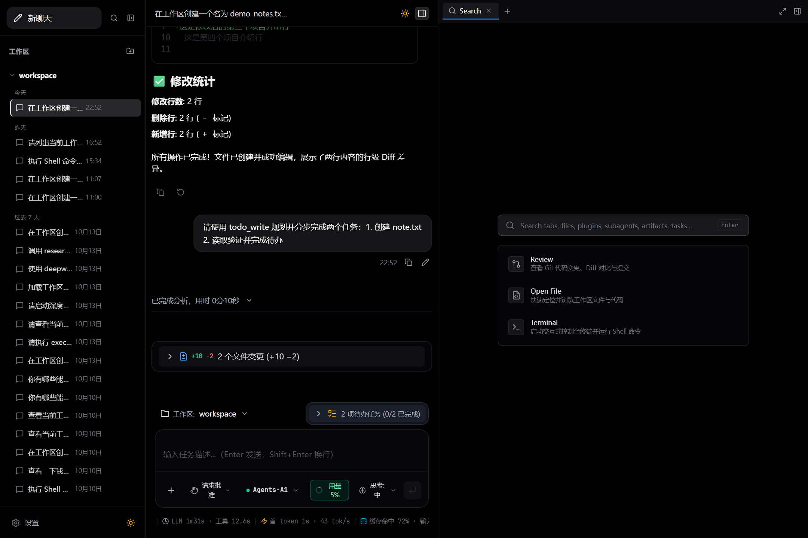

---

### 2. 现代输入框与模型切换列表 (Model Selector Dropdown)
输入框采用现代轻量药丸交互，点击模型胶囊按钮即可向上呼出可用模型列表，支持一键切换并快速跳转提供商设置。
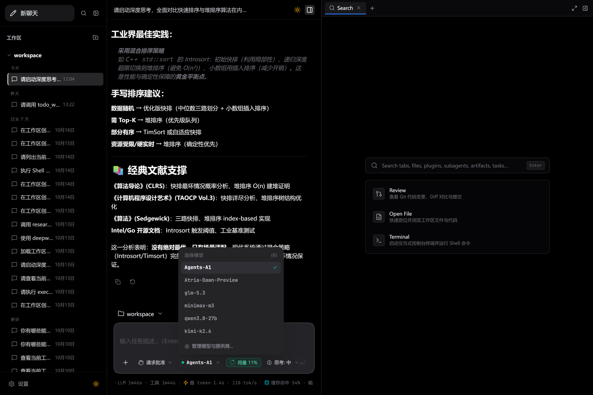

---

### 3. Token 用量环形仪表与会话消耗卡片 (Token Meter Card)
参考微软智能体交互体验，点击药丸环形进度圈弹出详细的 Token 占比分析卡片，直观展现输入输出消耗、首字延时、生成速度与上下文占比。
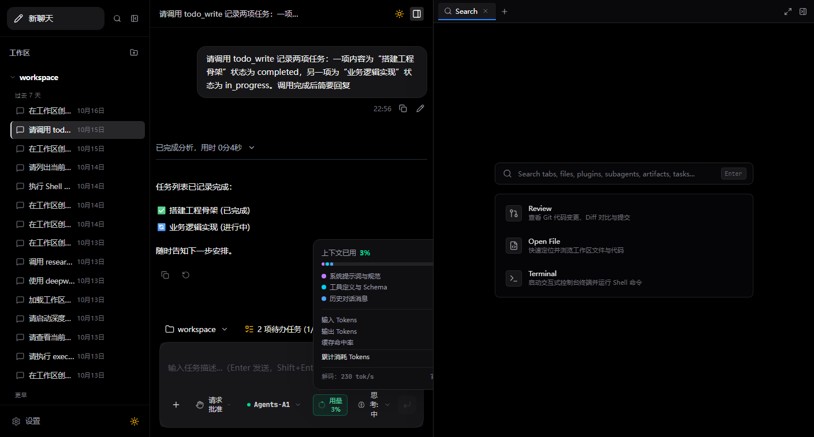

---

### 4. 背面折叠排队卡片与多分支引导 (Queued Prompt Folded Card)
模型在生成回复时再次发送提示词，可自由选择“加入排队”或“立即引导”；排队提示词优雅呈现在输入框背面上方（折叠卡片效果），支持随时编辑与撤回。
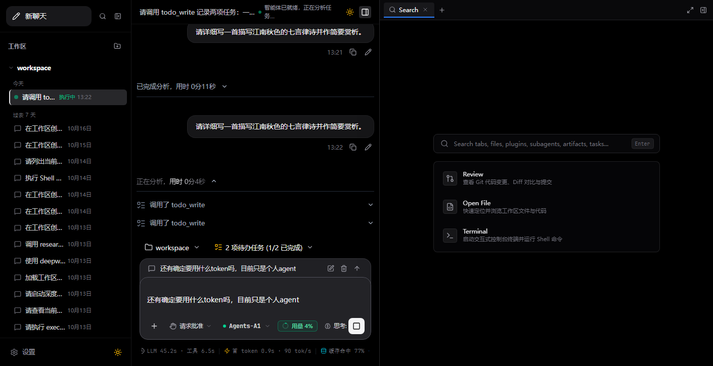

---

### 5. Shadcn UI 官方微光动态思考 (Shimmer Dynamic Thinking)
思维链及流式输出阶段采用官方 Shimmer 微光文字动效（`<p className="shimmer shimmer-color-blue-500/60">`），赋予思考过程流动质感。
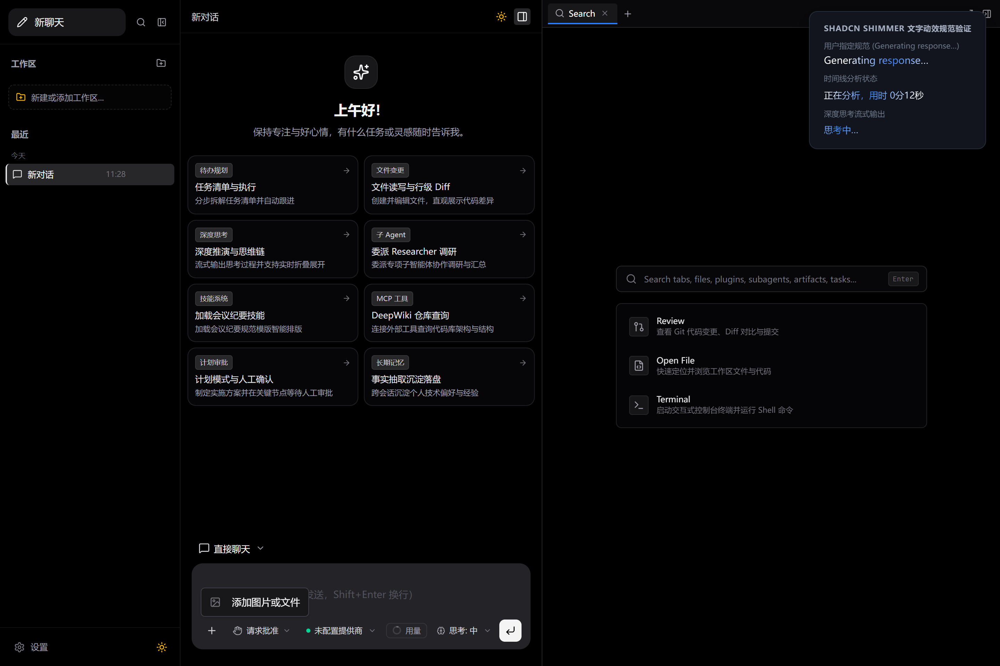

---

### 6. 模型厂商配置与未配置安全拦截 (Settings & Provider Protection)
设置中心支持自定义 API Base URL、多模型探测与持久化保存；若未配置可用提供商即尝试发信，将触发友好的安全拦截弹窗。

| 模型提供商管理与持久化保存 | 未配置 API 厂商安全拦截提醒 |
| :---: | :---: |
| 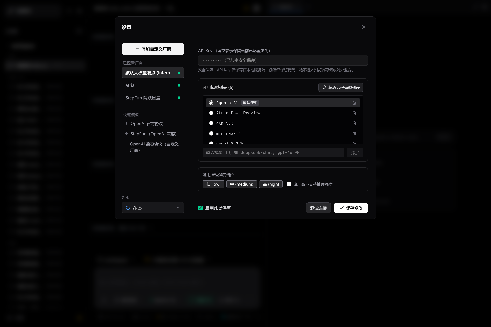 | 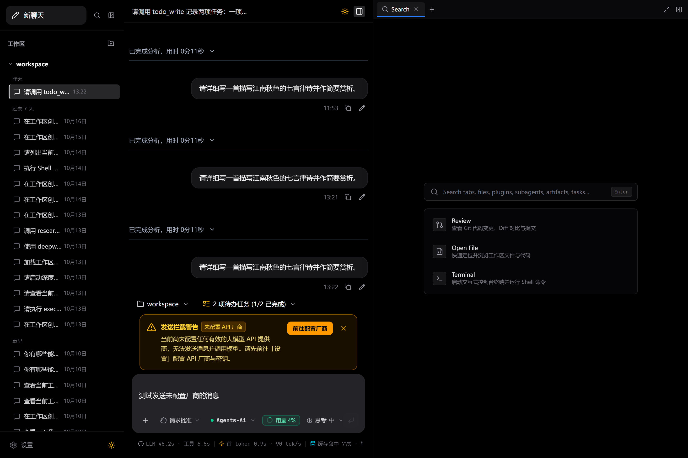 |

---

### 7. 任务清单 Todo 打勾联动与统计底栏 (Todo Tasks & StatsLine)
计划模式下生成的 Todo 任务列表与完成状态实时打勾联动，底部常驻 Token 与耗时统计底栏，保证工作区无遮挡。
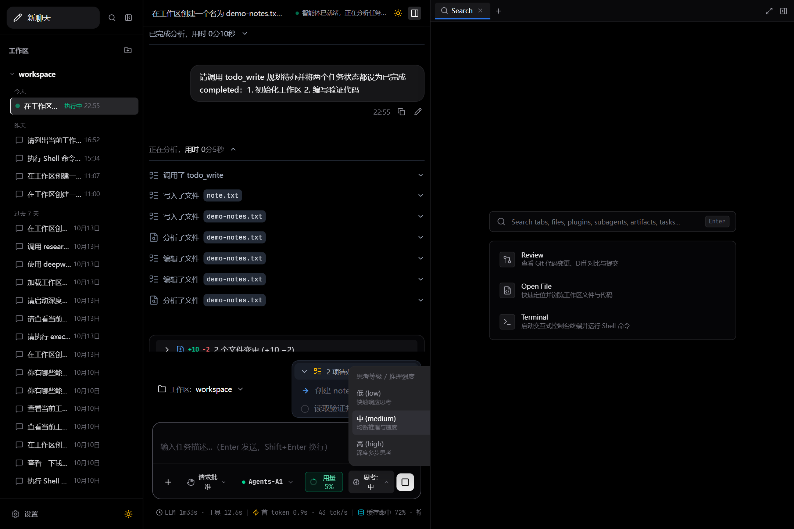

---

### 8. 多工作区与系统文件夹管理 (Workspace Folder Management)
支持选择默认工作区与自定义切换系统任意目录路径，一键新建工作区文件夹，全生命周期保障智能体文件读写安全隔离。
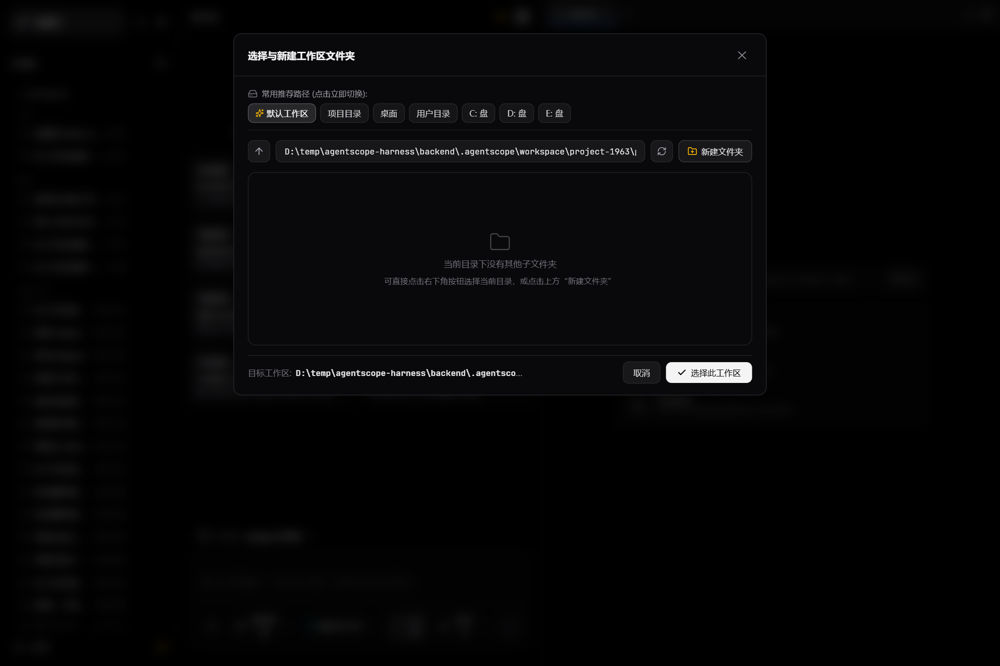

---

### 9. Git Diff 代码审查与内置交互式终端 (Review Diff & Terminal)
内置 LCS 行级代码差异高亮对比卡片、一键提交审查与系统终端命令执行窗口，打造闭环的智能体研发体验。

| Git Diff 差异对比审查 | 内置终端交互式命令行 |
| :---: | :---: |
| 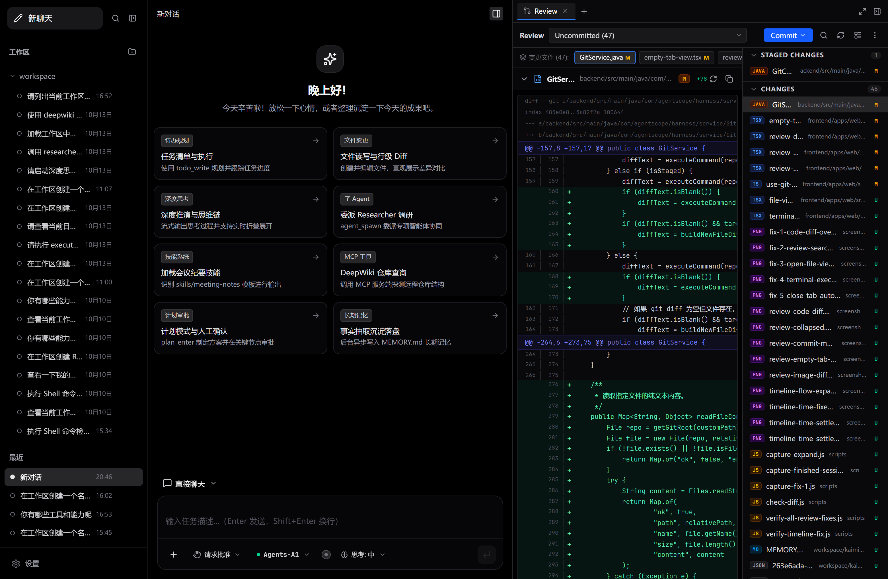 | 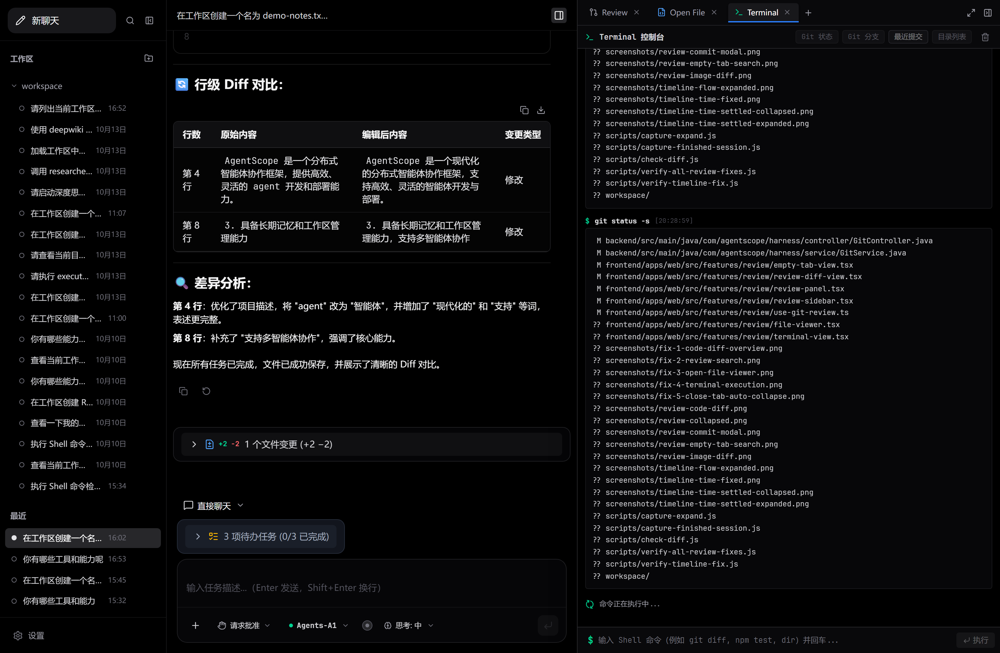 |

---

### 10. 极致黑白双色主题适配 (Dark & Light Theme)
支持深色（Dark）与浅色（Light）模式一键切换，所有下拉框、折叠卡片、统计栏与代码框均具备精细的双主题对比度优化。
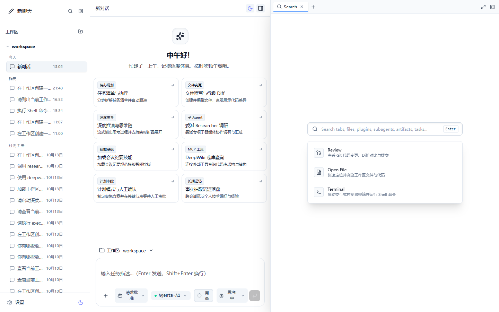

---

## 1. 架构总览

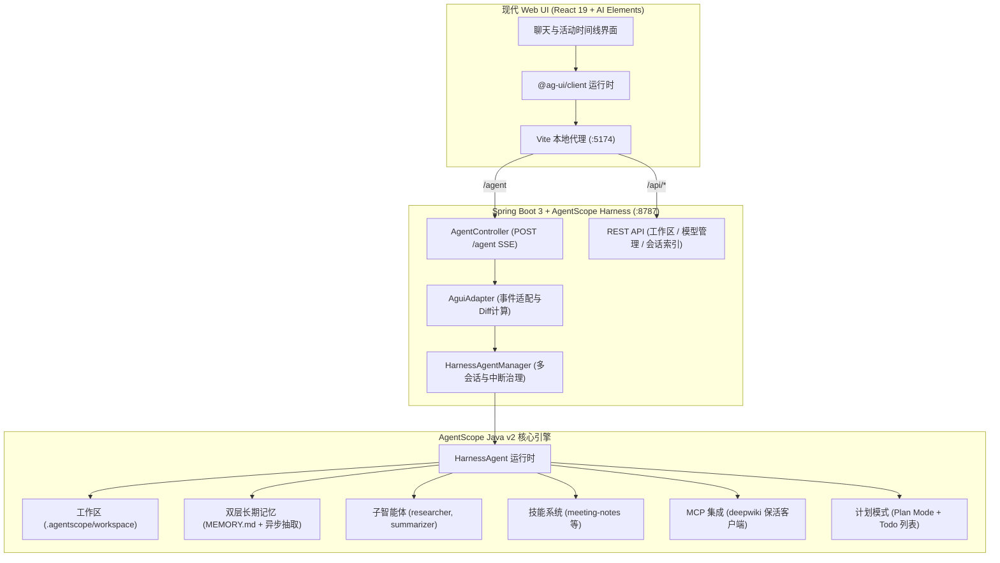

---

## 2. 后端全部内置能力与前端对接清单

| 功能模块 | AgentScope 内置机制 | 前端 AG-UI 对接方式 | 实测状态 |
| :--- | :--- | :--- | :---: |
| **工作区人格** | `.workspace(...)` + `AGENTS.md` | 遵循预设行为规范，用中文友好回答 | ✅ 已对接 |
| **流式正文输出** | `TextBlockDeltaEvent` | `TEXT_MESSAGE_START` / `TEXT_MESSAGE_CONTENT` / `TEXT_MESSAGE_END` 流式打字机渲染 | ✅ 已对接 |
| **思考流折叠/展开** | `ThinkingBlockDeltaEvent` | `REASONING_START` / `REASONING_CONTENT` / `REASONING_END`，AI Elements 折叠气泡展示已思考时长与思维链 | ✅ 已对接 |
| **任务清单 Todo** | `enableTaskList()` + `todo_write` | `CUSTOM` (`deepagent:activity` kind=todo)，前端实时展示待办任务清单卡片与进度条 | ✅ 已对接 |
| **文件变更 Diff** | `write_file` / `edit_file` + 前后快照对比 | 自动计算 LCS 行级增删差异，前端高亮渲染 `Δ +N -N` 差异预览卡片 | ✅ 已对接 |
| **工具调用卡片** | `ToolCallStart` / `ToolResultEnd` | `CUSTOM` (`deepagent:activity` kind=tool/file)，实时渲染参数摘要与执行耗时 | ✅ 已对接 |
| **子智能体协同** | `subagents/` + `SubagentDeclaration` | `CUSTOM` (`deepagent:activity` kind=subagent)，前端独立卡片呈现委派任务与报告摘要 | ✅ 已对接 |
| **技能库加载** | `skills/meeting-notes/` | 自动识别技能路径与参考模版并支持调用 | ✅ 已对接 |
| **MCP 工具集成** | `McpBootstrap` 短保活接管 | 自动连接 DeepWiki 等 MCP 服务端，掉线重连保活 | ✅ 已对接 |
| **双层长期记忆** | `AsyncMemoryFlushMiddleware` | 回合结束后后台抽取事实沉淀至 `memory/YYYY-MM-DD.md` 并合并至 `MEMORY.md` | ✅ 已对接 |
| **人工审批 (HITL)** | `RequireUserConfirmEvent` 权限确认 | AG-UI `interrupt` 机制，前端弹出审批确认卡片，提交后通过 `resume` 唤醒后续执行 | ✅ 已对接 |
| **多会话持久化** | `RuntimeContext` 会话隔离 | 各会话按 `threadId` 隔离记忆与活动日志，切换对话互不打扰 | ✅ 已对接 |
| **动态工作区树** | 文件系统 API | 实时获取工作区目录树、新建文件夹、切换根目录 | ✅ 已对接 |
| **多模型提供商** | `ProviderService` | 预置主流 OpenAI 兼容聚合端点，支持前端动态添加、测速与模型探测 | ✅ 已对接 |

---

## 3. 环境要求

- **JDK 17+ / JDK 21**（推荐 BellSoft / Oracle / OpenJDK 21）
- **Maven 3.9+**（项目支持使用本机或内置 Maven）
- **Node.js 20+**（推荐 Node.js 22 / 24）
- **pnpm 9+ / 10+**

---

## 4. 快速开始

### 4.1 一键启动（Windows）

直接双击根目录下的 `run.cmd` 即可：
- 自动检测并编译 Spring Boot 后端；
- 后台启动后端服务（`http://127.0.0.1:8787`）；
- 启动前端 Vite 开发服务器（`http://127.0.0.1:5174`）；
- 访问浏览器 `http://127.0.0.1:5174` 即可开始使用。

```cmd
run.cmd
```

### 4.2 手动分步启动

#### 终端 1：启动 Spring Boot 后端

```bash
cd backend
mvn clean package -DskipTests
java -Dfile.encoding=UTF-8 -jar target/agentscope-harness-spring-1.0.0.jar
```
后端服务端口为 `8787`，健康检查地址为 `http://127.0.0.1:8787/api/health`。

#### 终端 2：启动 Web 前端

```bash
cd frontend
pnpm install
pnpm --filter @deepagent/web dev --host 127.0.0.1 --port 5174
```
打开浏览器访问：`http://127.0.0.1:5174`。

---

## 5. 项目目录结构

```text
agentscope-harness/
├── backend/                              # Spring Boot 3 后端工程
│   ├── pom.xml                           # Spring Boot 3.4.3 + AgentScope Harness 2.0.3
│   └── src/main/java/com/agentscope/harness/
│       ├── AgentScopeApplication.java    # 启动主类
│       ├── config/                       # 配置属性与跨域 WebConfig
│       ├── controller/                   # AgentController, WorkspaceController, ProviderController 等
│       ├── service/                      # HarnessAgentManager, AguiAdapter, ProviderService 等
│       ├── middleware/                   # AsyncMemoryFlushMiddleware, ReflectionMiddleware
│       ├── mcp/                          # McpBootstrap 保活客户端
│       └── model/                        # AG-UI 事件流、Activity、Diff、RunSnapshot 模型
├── frontend/                             # Web 前端 UI 工程 (React 19 + AI Elements)
│   ├── package.json
│   ├── pnpm-workspace.yaml
│   ├── apps/web/                         # Vite 前端应用与 UI 组件
│   └── packages/shared/                  # 前后端通用数据结构定义
├── docs/                                 # 文档与预览资源
│   └── images/                           # 项目完整功能截图
├── .agentscope/workspace/                # 智能体默认工作区
│   ├── AGENTS.md                         # 人格与系统指令
│   ├── tools.json                        # 工具与 MCP 预设
│   ├── skills/meeting-notes/             # 预置技能模板
│   └── subagents/researcher.md           # 调研子智能体配置
├── run.cmd                               # Windows 一键启动脚本
├── run.sh                                # Linux/macOS 启动脚本
└── README.md                             # 项目说明文档
```

---

## 6. 服务端 API 接口清单

| 请求方式 | 路径 | 功能说明 |
| :--- | :--- | :--- |
| `GET` | `/api/health` | 健康检查与 AgentScope 运行状态 |
| `POST` | `/agent` | AG-UI 协议 SSE 流式执行端点 |
| `POST` | `/agent/cancel` | 中断取消指定会话的任务 |
| `GET` | `/api/workspace/tree` | 获取当前工作区文件目录树 |
| `POST` | `/api/workspace/select` | 切换当前工作区根目录 |
| `POST` | `/api/workspace/mkdir` | 在工作区内创建新目录 |
| `GET` | `/api/workspace/browse` | 浏览指定目录文件 |
| `GET` | `/api/providers` | 获取所有已配置大模型提供商（API Key 已掩码） |
| `POST` | `/api/providers` | 添加新的大模型提供商 |
| `PUT` | `/api/providers/{id}` | 更新提供商配置 |
| `DELETE` | `/api/providers/{id}` | 删除提供商配置 |
| `POST` | `/api/providers/{id}/models` | 远程探测提供商模型列表 |
| `POST` | `/api/providers/{id}/test` | 连通性与测速测试 |
| `GET` | `/api/workbench` | 获取工作台索引与会话列表 |
| `PUT` | `/api/workbench` | 更新工作台索引 |
| `GET/PUT/DELETE` | `/api/workbench/sessions/{threadId}` | 会话状态持久化与清理 |

---

## 7. 默认模型与环境变量配置

可在终端中设置以下环境变量以覆盖默认参数：

| 环境变量 | 默认值 | 说明 |
| :--- | :--- | :--- |
| `ATRIA_API_KEY` | 内置密钥 | 大模型 API Key |
| `ATRIA_BASE_URL` | `https://discovery-api.intern-ai.org.cn/v1` | OpenAI 兼容接口地址 |
| `ATRIA_MODEL` | `Agents-A1` | 默认模型名称 |
| `DEMO_WORKSPACE` | `.agentscope/workspace` | 智能体工作区根目录 |
| `DEMO_TURN_TIMEOUT_SECONDS` | `0`（不限） | 单轮最大超时秒数 |
| `DEMO_MCP_DEEPWIKI_URL` | `https://mcp.deepwiki.com/mcp` | DeepWiki MCP 服务器地址 |
